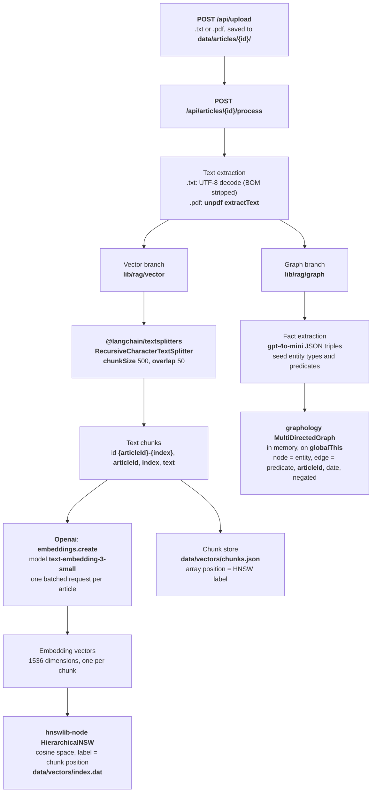
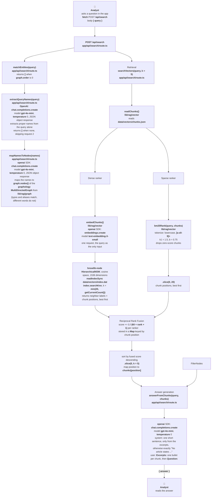

# Architecture

Analysts ask one question over a small set of articles. The service answers from those articles and cites each supporting article as **Graph** or **RAG**.

`Spec.md` is the product scope. `examples/cases.yaml` is the behavior the retrieval and the answer have to match.

## Libraries

FE & BE: `Next.js 16.4.0`

LLM Integration: `OpenAI API`, `LangChain.js`, `LlamaIndex.TS`

Vector Storage: `hnswlib-node`

Knowledge Graph: `graphology`

## Diagrams

### 1. Indexing

### 2. Query

