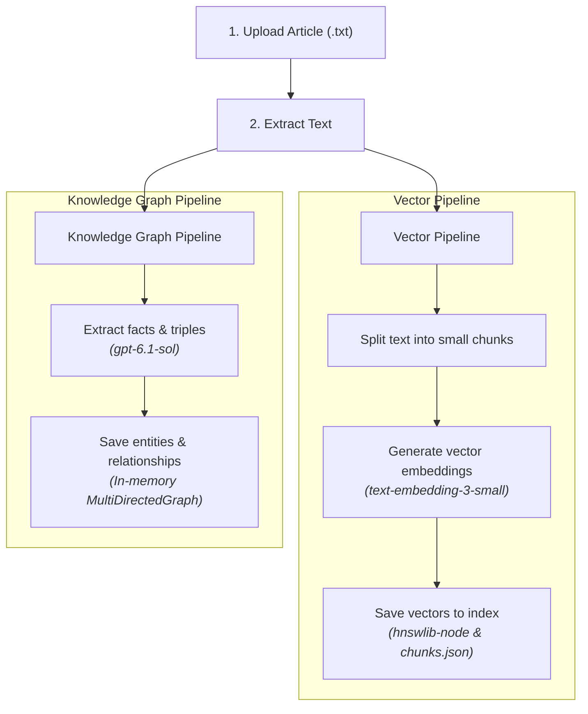
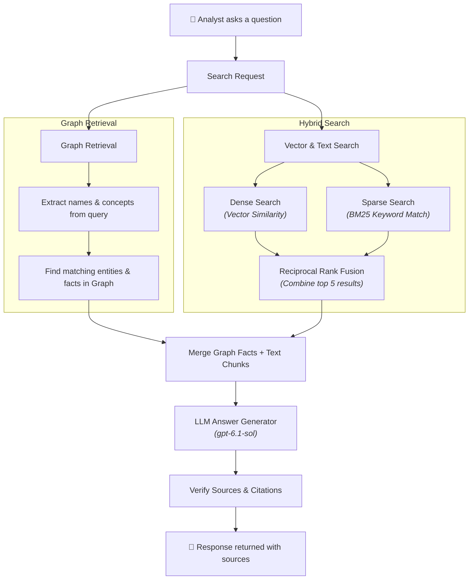

# next-insights-rag

Analysts ask one question over a small set of articles. The service answers from those articles 

## How to run it

Add `OPENAI_API_KEY` in `.env.local` and run:
```bash
nvm use 24.5.0
npm run dev
```

## Evaluation
`evalution` directory contains test cases, test runner, metrics and results


With the app running locally, run the evaluation test suite:

```bash
npm run evaluation
```
    

## Libraries

FE & BE: `Next.js 16.4.0`

LLM Integration: `OpenAI API`, `LangChain.js`

Vector Storage: `hnswlib-node`

Knowledge Graph: `graphology`

## API

- `GET /api/articles` - List articles
- `POST /api/articles/create` - Create an article from text
- `POST /api/upload` - Upload an article file (.txt)
- `POST /api/articles/[articleId]/process` - Process an article (extract graph/vectors)
- `POST /api/search` - Search through processed articles using query
- `DELETE /api/delete` - Delete all articles, graph and vectors

## Diagrams

### 1. Indexing



### 2. Query

